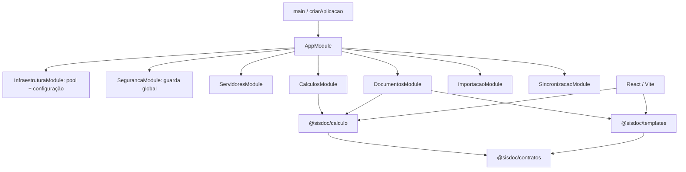

# Arquitetura e revisão estrutural

## Decisão e alcance

Em 01/11/2026 foi autorizada a revisão e refatoração por etapas, publicando
cada etapa validada. A aplicação continua um **monólito modular local**:
não foram introduzidos microsserviços, broker, ORM, outro banco ou ambientes
permanentes. Rotas, contratos, papéis, numeração, auditoria e comandos de
operação devem permanecer compatíveis.

A revisão inicial inspecionou o grafo de imports relativos de todos os
arquivos TypeScript/TSX/CJS de aplicações, pacotes, ferramentas, scripts e
testes. A leitura detalhada nesta etapa cobriu composição, bootstrap,
configuração, transações, guarda, erros e integração dos serviços no Nest.
Isso **não equivale a revisão semântica completa de cada função**, nem a
uma auditoria de vulnerabilidades ou nova certificação de concorrência.

## Diagnóstico inicial

Inventário após a extração dos módulos: 178 arquivos, incluindo 30 arquivos
de testes. Não foram encontrados ciclos nos imports locais resolvidos pela
análise estática. Imports dinâmicos, dependências de pacotes e relações
transacionais não são provados por essa verificação.

| Área | Diagnóstico | Tratamento |
|---|---|---|
| Monorepo | API, web, contratos, cálculo e templates já têm fronteiras úteis. | Preservar workspaces e separar responsabilidades dentro deles. |
| Composição API | Um único módulo registrava todos os controllers e factories. | Etapa 1: módulos NestJS por domínio, com serviços privados. |
| Infraestrutura | Pool/configuração precisam ser únicos; workers devem terminar antes de fechar o banco. | Etapa 1: módulo global restrito a esses dois recursos e encerramento testado. |
| Segurança | Guarda global aplica políticas e CSRF; serviços também confirmam sessão em transações. | Preservar as duas camadas; modularizar não substitui autorização. |
| Documentos | Rascunhos (~87 KB) e DTC (~55 KB) concentram consultas, cálculo e transições. | Revisar e extrair unidades coesas em etapa própria, preservando locks, revisões e atomicidade. |
| Cadastro e transferência | Cadastro importa um helper do exportador; rascunhos referenciam constantes de migrações. | Dependências existentes a revisar; não mover helpers ou constantes sem ler todos os consumidores. |
| Web | 25 arquivos na raiz, com editor DOF, DTC e cadastro extensos. Cliente HTTP reúne vários domínios. | Etapa 2: pastas por domínio, transporte compartilhado, clientes tipados e componentes Cadastro/DTC separados. Editor DOF e transferência ainda precisam decomposição. |
| Pacotes | Motor compartilhado evita divergência entre navegador/API; contratos e templates têm arquivos agregadores com lógica. | Preservar API pública; separar implementação dos exports quando os domínios forem revisados. |
| Testes | Fundação reúne instalação, banco, autorização e documentos em um arquivo amplo. | Preservar regressões; separar fixtures e suítes apenas com isolamento comprovado. |
| Documentação | Cobertura JSDoc é baixa: 14 de 811 declarações com corpo na varredura inicial, contando métodos e construtores. | Documentar função por função durante a revisão de cada módulo; não gerar comentários genéricos. |
| Operação | Aplicação inicia manualmente; backup e serviço automático continuam extras. | Não incluir novos recursos operacionais nesta refatoração. |

## Estrutura da API após a etapa 1

```text
apps/api/src/
  main.ts                         entrada operacional; pool e instalação
  aplicacao.ts                    HTTPS, CSP, assets e composição
  app.module.ts                   importa os módulos; não registra serviços
  injecao.ts                      identidade dos tokens BANCO/CONFIGURACAO
  infraestrutura/
    infraestrutura.module.ts      recursos únicos e encerramento do pool
    saude.controller.ts           diagnóstico público sem dados funcionais
  seguranca/seguranca.module.ts    autenticação, usuários e guarda global
  servidores/servidores.module.ts cadastro local e referências
  calculos/calculos.module.ts     cálculo pela API
  documentos/documentos.module.ts DOF, DTC, emissão, exclusão e worker PDF
  importacao/importacao.module.ts arquivos e promoção Legado → Núcleo
  sincronizacao/sincronizacao.module.ts integração externa e agendamento
  migracoes/                      versões e privilégios existentes
  setup/                          instalação, atualização e aprovação
```

Arquivos de infraestrutura já usados por CLI permanecem na raiz nesta
etapa. Em particular, `configuracao.ts` resolve a raiz a partir de
`__dirname`; movê-lo exige revisar seus consumidores e a instalação.
Não foram adicionados arquivos de compatibilidade nem reexports artificiais:
o teste de health passou a importar seu novo arquivo.



## Invariantes de modularização

### Interface — etapa 2

```text
apps/web/src/
  main.tsx                  montagem React e validação do elemento raiz
  aplicacao/app.tsx          sessão, navegação, menu e proteção de edição
  autenticacao/acesso.tsx    entrada e troca obrigatória de senha
  infraestrutura/
    http.ts                 transporte, erros e validação de respostas
    api.ts                  fachada tipada composta por domínio
    *.api.ts                autenticação, administração, cadastro,
                            sincronização, documentos, DOF e DTC
  compartilhado/            abas, filtros de lista e estilos
  administracao/            usuários e auditoria
  cadastro/                 lista, busca, detalhe, referências,
                            eventos e editor local
  dtc/                      lista, seleção, contexto, editor e documento
  dof/                      cálculo e etapas do fluxo DOF
  documentos/               histórico, emissão e exclusão
  transferencia/            importação/exportação, promoção e sincronização
```

Os componentes extraídos preservam sua posição na árvore React, chaves,
estado, efeitos e guardas de saída. O cliente continua usando a mesma
fachada `api`; transporte centraliza cookies, CSRF, prova da fonte, erros
e contratos sem duplicação. Imports dos consumidores foram atualizados,
sem criar wrappers para os caminhos antigos.

JSDoc específico cobre os clientes e transporte, autenticação/composição,
grupos Cadastro/DTC, filtros, abas e download de emissão. Isso ainda não
representa cobertura integral das funções web ou revisão semântica dos
grandes serviços. Typecheck e build web aprovados; **30 testes em quatro
suítes de navegador** passaram, incluindo rascunhos, DTC, transferência,
referências e cálculo no limite de tamanho.

- Registrar `InfraestruturaModule.registrar(...)` uma única vez no módulo
  raiz. Somente `BANCO` e `CONFIGURACAO` são exports globais.
- Controllers e serviços pertencem a seus módulos; não exportar tudo para
  evitar erros de injeção. Nova dependência entre domínios exige justificativa.
- Registrar a guarda por `APP_GUARD` no módulo de segurança; o escopo é
  global, mas `AutenticacaoService` permanece privado.
- Manter DOF, DTC, emissões e worker juntos até revisar suas fronteiras
  transacionais. Não dividir uma transação entre serviços ou abrir outro pool.
- Hooks `onModuleDestroy` dos workers precedem `onApplicationShutdown`
  do banco. Instanciar serviços por factories preserva esse ciclo NestJS.
- Pacotes compartilhados não importam aplicações. Cálculo não depende de
  HTTP, banco, sessão ou navegador; apresentação não decide autorização.
- Não mover migrações, mudar nomes de tabelas ou reimportar dados para
  acompanhar uma mudança de organização do código.

## Comentários dentro do código

### Serviços de documentos — etapa 3

O serviço DTC foi separado em:

- `calculos/calculo-dtc.ts`: adaptação pura do motor e linhas de totais;
- `documentos/consulta-dtc.ts`: leitura, decifração, validação e prova da fonte;
- `documentos/dtcs.ts`: autorização, locks e transições transacionais.

`ConsultasDtc` recebe o protetor existente e o `PoolClient` de cada operação.
Não abre conexão ou transação e não substitui os locks do serviço. Revisões,
conferência, idempotência, aprovação, numeração, snapshot e job PDF permanecem
atômicos. Todas as funções nomeadas dessas três unidades receberam JSDoc
específico após leitura do fluxo completo.

`resultado-transacao.ts` reúne o resultado discriminado e a tradução HTTP
antes duplicados em DTC, rascunhos DOF e emissões. A tradução permanece
**fora** da transação, preservando o commit da auditoria de falhas esperadas.
A mensagem comum de aprovação pertence a emissões, não ao serviço DOF.

Decifração textual do núcleo foi movida do exportador para proteção de dados,
eliminando a dependência do cadastro no domínio importação sem alterar
validação ou valores. O protetor e o exportador receberam JSDoc específico.

Typecheck aprovado e suíte completa **217/217 testes em 28 arquivos**,
incluindo quatro novos casos de resultado transacional e regressões HTTPS,
fonte DTC, cifragem, concorrência, documentos, importação e navegador.
Rascunhos DOF, importador e sincronização ainda precisam revisão/decomposição
aprofundadas; essa etapa não conclui a revisão integral.

Formato acordado: **JSDoc em cada função nomeada e método**, com propósito,
contrato relevante e efeitos/riscos não óbvios. Explicar referências entre
módulos, tokens e regras; não comentar indiscriminadamente imports,
callbacks anônimos ou variáveis autoexplicativas.

### Cálculo e contratos — etapa 4

Leitura do motor, calendário, histórico de vínculos, formatação e funções
nomeadas dos contratos. JSDoc específico adicionado sem mudar regras,
schemas, textos de saída ou máscaras. Varredura AST incluindo funções
declaradas e arrows atribuídas a nomes confirmou **20/20 funções no cálculo**
e **14/14 nos contratos** documentadas. Isso mede essas funções, não uma
certificação de todas as combinações dos schemas ou de regras administrativas.
Typecheck aprovado e **61 testes em três arquivos** passaram na seleção de
cálculo, contratos e DTC.

### Importador — etapa 5

O arquivo de coordenação foi reduzido de aproximadamente 830 para 120 linhas.
Responsabilidades separadas em `estado-importacao.ts`,
`gravacao-importacao.ts`, `relatorio-importacao.ts`,
`conferencia-importacao.ts` e `rollback-importacao.ts`.
CLI, interface, Legado e testes importam as unidades corretas diretamente;
não há wrappers de compatibilidade nos caminhos antigos. Gravação continua
recebendo o mesmo cliente e estado do lote, sem abrir transações adicionais.

**25/25 funções declaradas ou arrows nomeadas** dessas unidades têm JSDoc
específico. Política de preenchimento de vazios, cifra, identidades,
contagens, idempotência, relatórios e rollback LIFO preservados.

Corrigidas falhas silenciosas na limpeza e registro de falha:
erros de rollback e de gravação do lote agora preservam ambas as causas.
Falha no commit sinaliza estado incerto e exige conferir o lote antes de
repetir, sem registrar uma falha falsa. Conexões incertas são descartadas
na interface. Oito testes injetam falhas de BEGIN, ROLLBACK, COMMIT e registro
sem conectar a banco real.

Typecheck aprovado; suíte completa **225/225 testes em 29 arquivos**.
Esta etapa não conclui a revisão integral das outras unidades.

### Sincronização — etapa 6

Separados `mapeamento-sincronizacao.ts` (adaptação pura de nomes) e
`persistencia-sincronizacao.ts` (gravação por item), mantendo no serviço
paginação, staging, savepoints, retomada, disjuntor e reconciliação.
Persistência recebe o protetor e cliente existentes, sem abrir outro pool
ou transação. **34/34 funções/métodos/construtores e arrows nomeadas**
dessas três unidades foram documentados após leitura do fluxo completo.

Um novo teste revelou que mapeamento parcial descartava campos de vínculo
sem alias: o fallback buscava `vinculo.cargo` no objeto em vez de `cargo`.
Corrigido para conservar campos canônicos não renomeados. Cinco testes
puros cobrem aliases, zeros de matrícula, preservação da entrada e campos
inválidos, sem chamar API externa.

Falhas de agendamento, cursor ilegível, staging inválido, liberação de locks
e registro de falha agora têm mensagens técnicas explícitas e sanitizadas.
Conexão cujo desbloqueio falhar é descartada. O fluxo permanece não
bloqueante para emissão local; nenhuma configuração externa foi habilitada.

Typecheck aprovado; suíte completa **230/230 testes em 30 arquivos**.
**Revisão integral ainda pendente:** rascunhos DOF, demais serviços/helpers
não cobertos nestas etapas, templates, telas restantes, CLI/setup/ferramentas
e funções nomeadas dos testes. Organização do grafo e cobertura JSDoc
parcial não substituem essa leitura semântica.

A etapa 1 documenta funções da composição, configuração, bootstrap,
transações, health e tratamento de erros. Métodos de domínio, interface,
pacotes, CLI e ferramentas ainda precisam de revisão e documentação.
Não afirmar que “todo o código está comentado” até concluir essas etapas.

## Sequência e validação

### Modelos de saída versionados

Os formulários de referência usam CSS fixo compartilhado em
`packages/templates/src/versoes.ts`, brasão público incorporado em data URI
e valores HTML escapados. `modelo-dof.ts` é compartilhado entre prévia e
emissão v2; `emissao-dtc.ts` compõe os três formulários e o anexo de cálculo.
Os arquivos `emissao-dof-v1.ts` e `emissao-dtc-v1.ts` preservam as saídas
históricas; wrappers selecionam renderer pelo template do snapshot e
recusam versões desconhecidas.

`023-modelos-oficiais` cadastra versões novas, sem reaproveitar aprovação
antiga nem editar documentos/PDFs. Emissão, setup novo, migração de
instalação existente e CLI de aprovação compartilham `TEMPLATES_OFICIAIS`.
Prévias utilizam o formulário v2 sem simular emissão; produção exige
frontend/API/templates juntos por causa dos hashes CSP.
Detalhes: [decisão 029](decisoes/029-modelos-oficiais-versionados.md).

### DOF, templates e recursos CLI — etapa 7

```text
apps/api/src/documentos/
  rascunhos.ts       listas e transições de rascunhos/conferência
  contexto-dof.ts    tipos, confirmação de início, ordenação e diferenças
  consulta-dof.ts    consulta autorizada, prova de fonte e apresentação
  escrita-dof.ts     valores/ajustes cifrados no cliente existente
  emissao-dof.ts     emissão oficial e cópia com transação por operação
apps/web/src/dof/
  calculo-dof.tsx          apresentação dos painéis montados e prévia
  use-editor-dof.ts        cálculo, gravação e agregação das pendências
  contexto-editor-dof.ts   contrato do editor e campos/abas tipados
packages/templates/src/
  index.ts          somente exports públicos
  html.ts           escape, data e campo compartilhados
  previa-dof.ts     prévia provisória DOF
  emissao-dof.ts     snapshot DOF oficial
  emissao-dtc.ts     composição por tipo DTC
  variaveis-dof.ts   análise e valores de variáveis
apps/api/src/importacao/
  argumentos-cli.ts  leitura pura de flags/valores
  recursos-cli.ts    leitura limitada e conexão sem privilégios
  *.cli.ts          coordenação dos comandos, não helpers de outra CLI
```

Consultas/escrita DOF não possuem pool nem criam transações; usam o cliente
e locks da operação chamadora. Emissão/cópia são compostas pelo serviço
público com o mesmo pool/protetor/consultas/escrita. Não são novos providers
globais nem alteram controllers. O hook web preserva ordem dos estados,
cleanup e agregação das pendências; painéis ocultos permanecem montados.
Helpers de templates foram compartilhados somente após verificar
equivalência, sem mudar os CSS usados nos hashes CSP.

Na CLI, a confirmação e o modo de validação continuam na coordenação.
O protetor é construído antes da conexão para não deixar cliente aberto
caso a chave seja inválida. Falhas de conexão/encerramento são explícitas
e mantêm as causas; não há uso de dados de produção nos testes.

Evidências: 87 funções nomeadas documentadas nas unidades DOF/templates,
230 testes completos após a extração e 29 direcionados após recursos CLI
(oito novos nessa execução; suíte CLI final ampliada para nove aprovados).
JSDoc adicional cobre entradas setup/usuários, scripts e
fixtures revisados, não todas as funções do repositório.
Ver detalhes em [Progresso](PROGRESSO.md).

### Próximas etapas

1. **Composição API:** extração de módulos e testes de injeção, escopo,
   encerramento e regressão HTTPS/banco.
2. **Interface por domínio:** mover componentes e transporte com todos os
   imports atualizados; preservar estado, prévias, acessibilidade e proteção
   de alterações pendentes. Validar build e testes de navegador.
3. **Serviços de domínio:** decompor primeiro DOF/DTC e transferência após
   leitura das transições e testes; documentar cada função nomeada.
4. **Pacotes, CLI e testes:** finalizar organização, JSDoc e revisão de
   referências; executar regressão completa antes de declarar encerramento.

Usar `npm run typecheck`, `npm run build` e o runner existente
`node scripts\executar-testes.cjs`. Testes nunca usam a configuração
operacional. O teste de composição carrega o build CommonJS por
`createRequire` para preservar a identidade dos tokens/classes do Nest;
imports intermediados pelo runner podem criar outra identidade de símbolo.

A produção recebe apenas builds validados, com reinício controlado do PID
confirmado e verificação HTTPS. Nenhuma migração é necessária para a
extração dos módulos.
